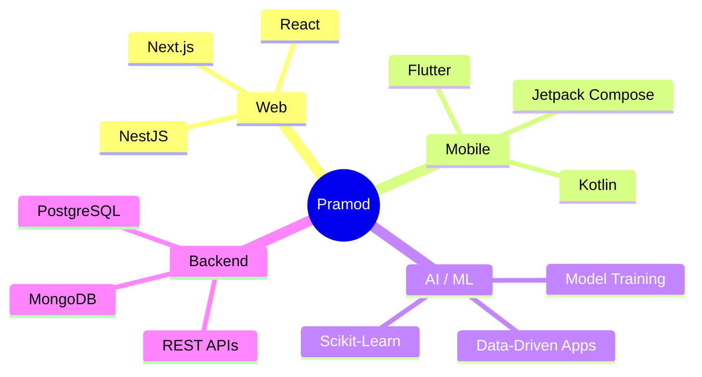

<!-- ═══════════════════════════ HEADER ═══════════════════════════ -->

 

  

  

 

<!-- ═══════════════════════════ QUOTE ═══════════════════════════ -->

> ### *"I believe in building attractive, meaningful, and user-focused solutions that solve real-world problems."*

<!-- ═══════════════════════════ ABOUT ═══════════════════════════ -->
## 👨‍💻 &nbsp;About Me

I'm a **Software Engineering Undergraduate** and **Full-Stack & Mobile App Developer**, shaped by continuous learning, hands-on projects and my studies at **NIBM**. My work spans **web apps · mobile apps · backend systems · databases · APIs · AI/ML model training**, and freelance and personal projects have taught me how to turn raw requirements into **practical, working products**.

  

<!-- ═══════════════════════════ FOCUS ═══════════════════════════ -->
## 🎯 &nbsp;Current Focus — 2026

> 🔭 Building **scalable web applications**, **robust backend systems** and **practical AI/ML solutions** with model training and data-driven development.

<!-- ═══════════════════════════ TECH STACK ═══════════════════════════ -->
## ⚡ &nbsp;Tech Arsenal

| Layer | Technologies |
| :---: | :--- |
| 🎨 **Frontend** |  |
| ⚙️ **Backend** |  |
| 📱 **Mobile** |  |
| 🗄️ **Databases** |   |
| 🛠️ **DevOps & Tools** |  |
| 🤖 **AI / ML** |    |

<!-- ═══════════════════════════ PROJECTS ═══════════════════════════ -->
## 🚀 &nbsp;Featured Projects

<table>
<tr>

<td width="33%" valign="top" align="center">

### 🌴 Iki Saki Travel
**Travel Tech · Full-Stack Web**

 

Responsive travel & tourism platform for exploring **Sri Lankan destinations, tour packages and travel services**.

 

  

</td>

<td width="33%" valign="top" align="center">

### 🥭 ML Price Prediction
**Machine Learning · Web App**

 

ML web app that predicts **fruit & vegetable prices** using environmental and historical data.

 

  

</td>

<td width="33%" valign="top" align="center">

### 🎨 Artévo
**E-Auction · Web & Mobile**

 

Full-featured platform for hosting **online art auctions with real-time bidding**, on web and mobile.

 

  

</td>

</tr>
</table>

<!-- ═══════════════════════════ STATS ═══════════════════════════ -->
## 📊 &nbsp;GitHub Analytics

<!-- ═══════════════════════════ PRINCIPLES ═══════════════════════════ -->
## 🧭 &nbsp;How I Build

<table>
<tr>
<td align="center" width="25%">🎯 <b>Purpose-Driven</b> Every feature solves a real problem</td>
<td align="center" width="25%">🧩 <b>Clean & Scalable</b> Maintainable architecture from day one</td>
<td align="center" width="25%">✨ <b>User-Focused</b> Attractive, intuitive experiences</td>
<td align="center" width="25%">🔁 <b>Always Learning</b> Consistency over intensity</td>
</tr>
</table>

<!-- ═══════════════════════════ CONTACT ═══════════════════════════ -->
## 🤝 &nbsp;Let's Connect

  

**📧 pramodsiriwardhana@outlook.com**

 

