

<picture>
  <source media="(max-width: 767px) and (prefers-color-scheme: light)" srcset="assets/light/header.mobile.svg">
  <source media="(max-width: 767px)" srcset="assets/dark/header.mobile.svg">
  <source media="(prefers-color-scheme: light)" srcset="assets/light/header.svg">
  
</picture>

<a href="https://pramod-siriwardhana.vercel.app/"><picture>
  <source media="(prefers-color-scheme: light)" srcset="https://img.shields.io/badge/PORTFOLIO-f6f8fa?style=for-the-badge&logo=vercel&logoColor=0891b2&labelColor=f6f8fa&color=e2e8f0">
  
</picture></a>
<a href="https://www.linkedin.com/in/pramod-siriwardhana"><picture>
  <source media="(prefers-color-scheme: light)" srcset="https://img.shields.io/badge/LINKEDIN-f6f8fa?style=for-the-badge&logo=linkedin&logoColor=2563eb&labelColor=f6f8fa&color=e2e8f0">
  
</picture></a>
<a href="https://github.com/pramodSiriwardhana"><picture>
  <source media="(prefers-color-scheme: light)" srcset="https://img.shields.io/badge/GITHUB-f6f8fa?style=for-the-badge&logo=github&logoColor=24292f&labelColor=f6f8fa&color=e2e8f0">
  
</picture></a>
<a href="https://wa.me/94702705781"><picture>
  <source media="(prefers-color-scheme: light)" srcset="https://img.shields.io/badge/WHATSAPP-f6f8fa?style=for-the-badge&logo=whatsapp&logoColor=16a34a&labelColor=f6f8fa&color=e2e8f0">
  
</picture></a>

<picture>
  <source media="(max-width: 767px) and (prefers-color-scheme: light)" srcset="assets/light/metrics.mobile.svg">
  <source media="(max-width: 767px)" srcset="assets/dark/metrics.mobile.svg">
  <source media="(prefers-color-scheme: light)" srcset="assets/light/metrics.svg">
  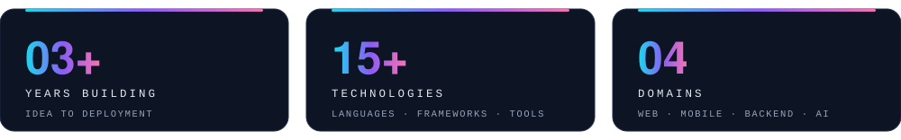
</picture>

<picture>
  <source media="(max-width: 767px) and (prefers-color-scheme: light)" srcset="assets/light/t-about.mobile.svg">
  <source media="(max-width: 767px)" srcset="assets/dark/t-about.mobile.svg">
  <source media="(prefers-color-scheme: light)" srcset="assets/light/t-about.svg">
  
</picture>
<picture>
  <source media="(max-width: 767px) and (prefers-color-scheme: light)" srcset="assets/light/about.mobile.svg">
  <source media="(max-width: 767px)" srcset="assets/dark/about.mobile.svg">
  <source media="(prefers-color-scheme: light)" srcset="assets/light/about.svg">
  
</picture>

<picture>
  <source media="(max-width: 767px) and (prefers-color-scheme: light)" srcset="assets/light/t-stack.mobile.svg">
  <source media="(max-width: 767px)" srcset="assets/dark/t-stack.mobile.svg">
  <source media="(prefers-color-scheme: light)" srcset="assets/light/t-stack.svg">
  
</picture>
<picture>
  <source media="(max-width: 767px) and (prefers-color-scheme: light)" srcset="assets/light/stack.mobile.svg">
  <source media="(max-width: 767px)" srcset="assets/dark/stack.mobile.svg">
  <source media="(prefers-color-scheme: light)" srcset="assets/light/stack.svg">
  
</picture>

<picture>
  <source media="(max-width: 767px) and (prefers-color-scheme: light)" srcset="assets/light/t-projects.mobile.svg">
  <source media="(max-width: 767px)" srcset="assets/dark/t-projects.mobile.svg">
  <source media="(prefers-color-scheme: light)" srcset="assets/light/t-projects.svg">
  
</picture>
<a href="https://www.ikisakitours.com"><picture>
  <source media="(max-width: 767px) and (prefers-color-scheme: light)" srcset="assets/light/p1.mobile.svg">
  <source media="(max-width: 767px)" srcset="assets/dark/p1.mobile.svg">
  <source media="(prefers-color-scheme: light)" srcset="assets/light/p1.svg">
  
</picture></a>
<a href="https://github.com/pramodSiriwardhana/Fruits-Vegetables-Ml-Price-Prediction"><picture>
  <source media="(max-width: 767px) and (prefers-color-scheme: light)" srcset="assets/light/p2.mobile.svg">
  <source media="(max-width: 767px)" srcset="assets/dark/p2.mobile.svg">
  <source media="(prefers-color-scheme: light)" srcset="assets/light/p2.svg">
  
</picture></a>
<a href="https://github.com/pramodSiriwardhana/HND_FINAL_Artevo_web"><picture>
  <source media="(max-width: 767px) and (prefers-color-scheme: light)" srcset="assets/light/p3.mobile.svg">
  <source media="(max-width: 767px)" srcset="assets/dark/p3.mobile.svg">
  <source media="(prefers-color-scheme: light)" srcset="assets/light/p3.svg">
  
</picture></a>

<picture>
  <source media="(max-width: 767px) and (prefers-color-scheme: light)" srcset="assets/light/t-stats.mobile.svg">
  <source media="(max-width: 767px)" srcset="assets/dark/t-stats.mobile.svg">
  <source media="(prefers-color-scheme: light)" srcset="assets/light/t-stats.svg">
  
</picture>

<picture>
  <source media="(prefers-color-scheme: light)" srcset="https://github-readme-stats-pramod.vercel.app/api?username=pramodSiriwardhana&hide_border=false&border_radius=16&border_color=d0d7de&bg_color=ffffff&title_color=0891b2&text_color=334155&icon_color=7c3aed&show_icons=true&count_private=true&include_all_commits=true">
  
</picture>
<picture>
  <source media="(prefers-color-scheme: light)" srcset="https://github-readme-stats-pramod.vercel.app/api/top-langs/?username=pramodSiriwardhana&hide_border=false&border_radius=16&border_color=d0d7de&bg_color=ffffff&title_color=0891b2&text_color=334155&layout=compact&langs_count=8">
  
</picture>

<picture>
  <source media="(max-width: 767px) and (prefers-color-scheme: light)" srcset="assets/light/contact-card.mobile.svg">
  <source media="(max-width: 767px)" srcset="assets/dark/contact-card.mobile.svg">
  <source media="(prefers-color-scheme: light)" srcset="assets/light/contact-card.svg">
  
</picture>

[✉ Send me an email](mailto:pramodsiriwardhana@outlook.com)

<picture>
  <source media="(max-width: 767px) and (prefers-color-scheme: light)" srcset="assets/light/footer.mobile.svg">
  <source media="(max-width: 767px)" srcset="assets/dark/footer.mobile.svg">
  <source media="(prefers-color-scheme: light)" srcset="assets/light/footer.svg">
  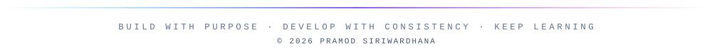
</picture>

